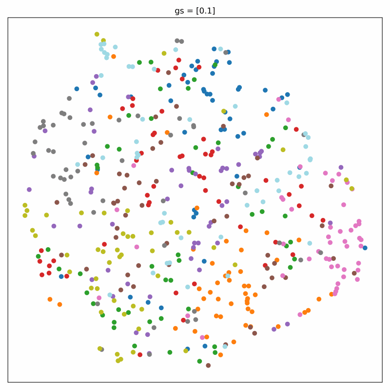

# Potts Model Clustering (Super-Paramagnetic Clustering)

Unsupervised data clustering based on the physical properties of an inhomogeneous ferromagnetic $q$-state Potts model.



## Overview

**Super-Paramagnetic Clustering (SPC)** is a physics-inspired, non-parametric clustering algorithm introduced by Blatt, Wiseman, and Domany (1996). Rather than assuming globular cluster shapes or requiring the number of clusters $k$ to be specified in advance, SPC maps data points to interacting Potts spins and identifies natural clusters across temperature-driven phase transitions:

- **Ferromagnetic Phase ($T < T_{\text{fs}}$):** All spins align into a single macroscopic cluster.
- **Superparamagnetic Phase ($T_{\text{fs}} < T < T_{\text{ps}}$):** Strongly coupled spins within dense regions remain aligned while weakly coupled regions decorrelate, revealing hierarchical cluster structure without a priori knowledge of cluster count.
- **Paramagnetic Phase ($T > T_{\text{ps}}$):** Thermal fluctuations dominate and spin orientations become completely disordered.

## Methodology

Given $N$ data points $\{\mathbf{x}_i\}_{i=1}^N$, each point is assigned a discrete spin variable $s_i \in \{1, 2, \dots, q\}$ governed by the ferromagnetic Potts Hamiltonian:

$$\mathcal{H}(\mathbf{s}) = -\sum_{\langle i, j \rangle} J_{ij} \, \delta(s_i, s_j)$$

where $\delta(s_i, s_j) = 1$ if $s_i = s_j$ and $0$ otherwise, and the sum runs over pairs $\langle i, j \rangle$ connected in a $K$-nearest-neighbor ($K$-NN) graph. Interaction strengths decay with pairwise distance $d_{ij} = \|\mathbf{x}_i - \mathbf{x}_j\|$:

$$J_{ij} = \frac{1}{\hat{K}} \exp\!\left(-\frac{d_{ij}^2}{2 a^2}\right)$$

where $a$ is the characteristic local length scale (typically the average $K$-NN distance) and $\hat{K}$ normalizes the average coordination number.

At temperature $T$, equilibrium spin-spin correlations $G_{ij} = \langle \delta(s_i, s_j) \rangle$ and magnetic susceptibility $\chi(T)$ are estimated via Monte Carlo simulation (such as the Swendsen-Wang cluster algorithm). Connected components where $G_{ij} > \theta$ define the cluster assignments at each temperature regime.

## Repository Structure

```text
potts-model-clustering/
├── super-paramagnetic-clustering.py   # Full Super-Paramagnetic Clustering implementation
├── fast-SP-clustering.py              # Accelerated / streamlined SPC variant
├── anigif.gif                         # Animated visualization of spin configurations / clustering across T
└── README.md                          # Project documentation
```

## Getting Started

### Prerequisites

- Python 3.8+
- `numpy`
- `scipy`
- `matplotlib` (for visualization and animation output)

Install dependencies:

```bash
git clone https://github.com/lyelibi/potts-model-clustering.git
cd potts-model-clustering
pip install numpy scipy matplotlib
```

### Running the Scripts

Run the standard Super-Paramagnetic Clustering implementation:

```bash
python super-paramagnetic-clustering.py
```

Run the fast SPC implementation:

```bash
python fast-SP-clustering.py
```

## Key Hyperparameters

| Parameter | Symbol | Description |
| :--- | :---: | :--- |
| Potts states | $q$ | Number of discrete spin states available to each data point (commonly $q = 10$ or $q = 20$). |
| Neighbors | $K$ | Number of nearest neighbors defining the sparse interaction graph. |
| Temperature | $T$ | Control parameter swept across phase transitions to resolve hierarchical cluster granularity. |
| Correlation threshold | $\theta$ | Cutoff on the pairwise spin-spin correlation $G_{ij}$ used to form cluster edges. |

## References

1. Blatt, M., Wiseman, S., & Domany, E. (1996). *Superparamagnetic clustering of data*. Physical Review Letters, 76(18), 3251-3254.
2. Blatt, M., Wiseman, S., & Domany, E. (1997). *Data clustering using a model granular magnet*. Neural Computation, 9(8), 1805-1842.
3. Swendsen, R. H., & Wang, J. S. (1987). *Nonuniversal critical dynamics in Monte Carlo simulations*. Physical Review Letters, 58(2), 86-88.

## Citation

```bibtex
@software{yelibi_potts_clustering,
  author = {Yelibi, Lionel},
  title  = {Potts Model Clustering},
  url    = {https://github.com/lyelibi/potts-model-clustering}
}
```

## License

This project is open source; see the repository license for terms of use.
